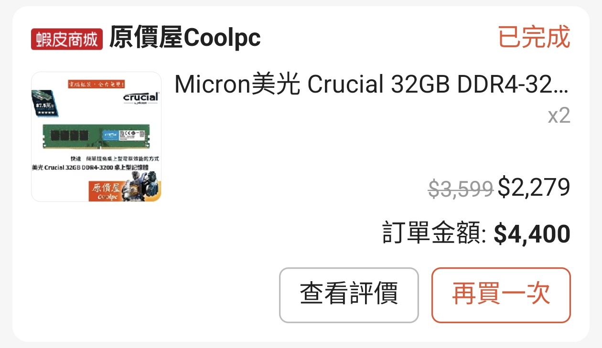
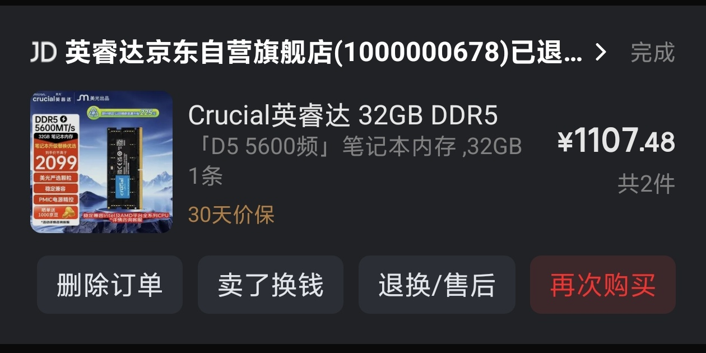
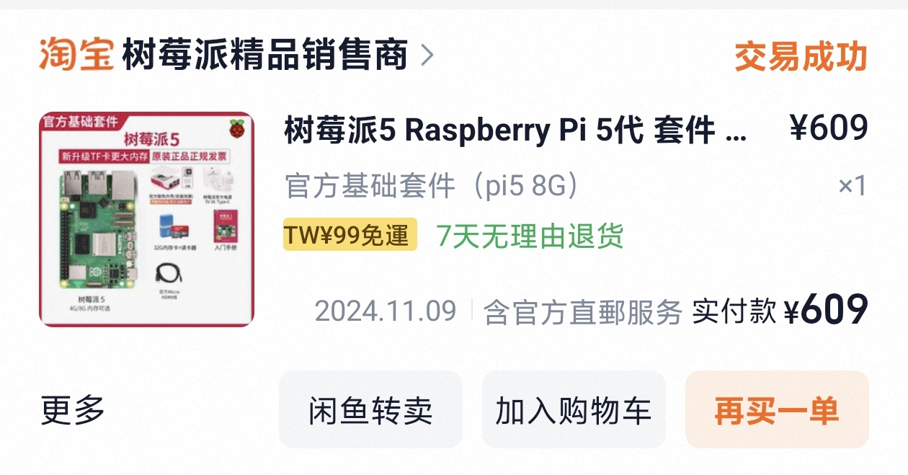

> [!TIP]
> 這不會成為系列文章，也絕對不是在炫富！


這篇真的超隨性！


# 我在 2024 年買了一堆記憶體！

好拉有一個是 2023 年

## 20230325 美光 DDR4 3200 32Gx2

台幣 4400

**相近規格現今參考價格：16598 台幣，差價 12198** 

參考基準：威剛 32GB(雙通16G\*2) D4-3200/CL16 D10超頻 黑｛AX4U3200716G16A-DB10｝(2048\*8), $8299，兩組 16598，原價屋找不到 32Gx2 了

我現在的電腦是 2022 買的，雖有 32G 記憶體，但很快就被我用完了，所以就升級上去了，原本的 16Gx2 就 2500 賣朋友了，他也是 16Gx2 用完，加上我賣他的，他也就有 64G 記憶體了（不過得降低記憶體頻率才能穩）

## 20240617 京東 DDR5 5600 SODIMM 32Gx2

**DDR5 來了！**

人民幣 1107，當時大概台幣 5000

**相近規格現今參考價格：30000 台幣，差價 25000**

參考基準：
1. 威剛 NB 32GB DDR5-5600/CL46｛AD5S560032G-S｝, $14999，兩條就變 3 萬
2. 美光｛Micron Crucial NB 64GB DDR5 5600｝/CL46, $28888，單條價格差不多，但條數低的情況下，價格之間相互有參考價值

看時間，對，就是 618 購物節，購買原因是因為我預定了 Framework Laptop 13 Core Ultra Series 1 Ultra 5 125H，雖然從買來至今都裝著 Linux，但我想說只有兩個記憶體插槽，就要一次裝到滿才不會後悔。老實說台灣的價差並不大，原價屋貴 500 台幣，但我覺得不省白不省。

## 20240916 美光 Crucial PRO DDR5 6000 16Gx2

2777 台幣！

**相近規格現今參考價格：15999 台幣，差價 13222** 

參考基準：
1. 威剛 32G(雙通16G*2)D5-6000/CL36 LancerBlade矮 黑｛AX5U6000C3616G-DTLABBK｝, $17799
2. 威剛 32G(雙通16G*2)D5-6000/CL36 LancerBlade矮 黑｛AX5U6000C3616G-DTLABBK｝~組裝價~, $15999

這是我媽的電腦，原本的電腦是 i5 4 gen 的，毛病已經多到受不了，就組新的了。

另外還有 SSD，WD SN580 1TB 1800 台幣

**相近規格現今參考價格：4990 台幣，差價 3190**

參考基準：
1. WD 藍標｛SN5100 1TB｝/Gen4 PCIe 4.0/讀7100/寫6700/QLC【五年保】, $5780
2. WD 藍標｛SN5100 1TB｝/Gen4 PCIe 4.0/讀7100/寫6700/QLC【五年保】~組裝價~, $4990 Hot！

{{
}}
|品名|產品名稱|備註|數量|小計|
|--|--|--|--|--|
|主機板 MB|【狂】華碩 PRIME B760M-A WIFI-CSM + Intel i5-14500【14核/20緒】-至9/30止, $11790 ★|Intel B760 / 1700 腳位 (DDR5)-12~14代皆支援|1|11790|
|記憶體 RAM|美光Micron Crucial PRO 超頻 32GB(雙通16GB*2) D5 6000/CL36 黑色散熱片【雙參數】, $2777 ◆ ★|桌上型記憶體 DDR5 雙通道|1|2777|
|固態硬碟 M.2 SSD|WD 藍標 SN580 1TB/Gen4 PCIe 4.0/讀:4150/寫:4150/TLC【五年】, $2200↘$1880 ◆ ★ 熱賣|	M.2 PCIe 4.0 (Gen4) SSD固態硬碟|1|1880|
|散熱器｜散熱墊｜散熱膏|利民 Burst Assassin 120 /6導管(6mm)/高15.4cm【WXHZ】, $990 ◆ ★|利民 Thermalright(索摩樂) 散熱器|1|990|
|CASE 機殼(+電源)|Antec P5 顯卡長36/CPU高15.5/靜音設計/M-ATX, $1690 ◆ ★|安鈦克 Antec 機殼|1|1690
|電源供應器|全漢 HYDRO GSM PRO 550W 雙8/金牌/半模/全日系/10年保, $2090 ◆ ★|全漢 FSP 電源供應器【原價屋售出 2年快換 電供就是穩 !!】|1|2090|
|||2024/09/16 星期一 ||21217|
{{
}}

## 20241109 Raspberry Pi 5 8G

人民幣 609，台幣大約近 3000

**相近規格現今參考價格：1742 人民幣，約 8620 台幣，差價 5620**

而且還是全套裝，含原廠機殼、電源還有一個 SanDisk 32G 記憶卡，到現在都沒壞，雖然現在只有拿來跑 BOINC 跟 DNS Resolver 就是，挺浪費的。

## Misc

我沒辦法精準列出時間點跟價格的放這

說是這麼說，但又寫了精準時間是因為我在 Email 查到了

1. TEAM ELITE DDR5 4800 32Gx1 SODIMM：20231110，2499 台幣，現在要約 15000，這是拿來給我買的 Intel N100 mini PC 跑 PVE 的，當時 DDR5 還是當時的偏高點，（跟現在不能比），我當時堅持咬牙一定要買 DDR5 版本真是先知。
2. TEAM MP33 Pro 1TB：20231110，同上，給 N100 用的，1399 台幣
3. Samsung 970 EVO Plus 1TB x2：2022 年不同時間買的，一個約 3200，一個 2500，我現在這台電腦組裝當年買的。
4. WD SN570 1TB: 20230816，PChome 24H 購入，買給我 Framework Laptop 裝，用到現在，因為 PChome 系統異常，我有大量中間段的購買紀錄消失（但更老的找的到），價格經過 ChatGPT 查詢，當時是 940，沒錯就是 940 台幣，現在價格又要多少？上面有寫。 後來又從 Email 查到準確日期了。

## Note

1. 現今參考價格以 20261112 原價屋系統為主


發大財哈哈哈哈！！！！

